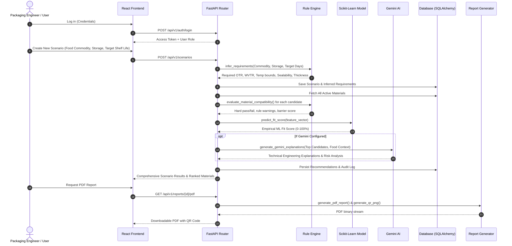

# PackSage AI (PackWise AI) — Comprehensive Architecture & Process Documentation

> **SIH Problem Statement / Project:** AI-Assisted Food Packaging Decision Support System (SIH260236)  
> **Platform Name:** PackSage AI / PackWise AI  
> **Repository:** `c:\Users\mannj\Downloads\236`

---

## 1. Executive Summary & Vision

**PackSage AI** is an intelligent, full-stack, enterprise-grade decision support platform built to optimize food packaging material selection. Choosing food packaging requires balancing complex, competing parameters:
- **Food Preservation & Barrier Requirements:** Moisture barrier (WVTR), Oxygen barrier (OTR), Respiration rates, pH sensitivity, and fat oxidation.
- **Storage & Environmental Conditions:** Ambient, chilled, and frozen thermal envelopes, target relative humidity (RH), and desired shelf life.
- **Sustainability & Environmental Footprint:** Carbon footprint, recyclability, compostability, and circular economy metrics.
- **Economic Viability:** Material cost per kg/sqm, sealing compatibility, and processing machinery tolerances.
- **Compliance & Transparency:** Food-contact compliance (FDA/FSSAI/EU), deterministic engineering rule verification, explainable ML ranking, generative AI engineering rationales, and QR-verifiable PDF audit reports.

---

## 2. System Architecture

The project is structured as a decoupled client-server architecture with an asynchronous backend engine, an integrated machine learning model, rule engines, generative AI reasoning, and a modern responsive dashboard frontend.

```
                              ┌────────────────────────────────────────┐
                              │           Frontend (Vite/React)        │
                              │  Tailwind CSS v4 + Lucide + i18n       │
                              │  TanStack Query + Axios Client         │
                              └──────────────────┬─────────────────────┘
                                                 │ HTTP / REST
                                                 ▼
                              ┌────────────────────────────────────────┐
                              │          FastAPI Backend Engine        │
                              │      CORS, Pydantic, Argon2id, JWT     │
                              └───────┬──────────────┬───────────────┬─┘
                                      │              │               │
            ┌─────────────────────────┴────┐   ┌─────┴──────┐   ┌────┴──────────────────────────┐
            ▼                              ▼   ▼            ▼   ▼                               ▼
┌──────────────────────┐        ┌───────────────────┐ ┌───────────────────┐        ┌──────────────────┐
│ SQLite / PostgreSQL  │        │   Rule Engine     │ │   Scikit-Learn    │        │  Google Gemini   │
│ SQLAlchemy 2.0 ORM   │        │ Deterministic OTR │ │  Random Forest    │        │ Generative AI    │
│ Users, Scenarios,    │        │ WVTR, Temperature │ │  Empirical Fit    │        │ Engineering      │
│ Materials, Audits    │        │ & Barrier Rules   │ │  Scoring Engine   │        │ Rationale Gen    │
└──────────────────────┘        └───────────────────┘ └───────────────────┘        └──────────────────┘
                                                 │
                                                 ▼
                                ┌───────────────────────────────────┐
                                │     ReportLab & QR Generator      │
                                │   Downloadable PDF & QR Trace     │
                                └───────────────────────────────────┘
```

---

## 3. Technology Stack Breakdown

### Frontend
- **Framework:** React 18 with TypeScript and Vite.
- **Styling:** Tailwind CSS v4 with custom glassmorphism and modern dashboard cards.
- **Icons:** `lucide-react`.
- **State Management & Server Cache:** `@tanstack/react-query` (with 60s stale time and background sync).
- **Routing:** `react-router-dom` v6 with role-based routing (`RequireAuth`, `RequireRole`).
- **Internationalization:** Multi-language support setup (`i18n.ts` and locales).
- **Charts / Visualizations:** Dynamic CSS score meters, barrier radar-style comparison gauges, and sustainability metrics.

### Backend
- **Framework:** FastAPI (Python 3.10+ / 3.12).
- **Server:** Uvicorn with auto-reload.
- **Database ORM:** SQLAlchemy 2.0 (configured for SQLite by default, seamlessly switchable to PostgreSQL via `DATABASE_URL`).
- **Validation & Serialization:** Pydantic v2 schemas.
- **Security:** Argon2id password hashing, JWT Bearer tokens with OAuth2 flows, and RBAC (`admin`, `engineer`, `viewer`).
- **Machine Learning:** `scikit-learn` (`RandomForestRegressor`, `StandardScaler`, `Pipeline`), `numpy`.
- **Generative AI:** Google Gemini API (`google.generativeai` with fallback heuristics).
- **Report & Document Generation:** `reportlab` for vector PDF rendering, `qrcode` / `pillow` for scannable traceability labels.

---

## 4. End-to-End Business Logic & User Flow



---

## 5. Detailed Core Modules

### 5.1. Authentication & Role-Based Access Control (RBAC)
- **Token Handling:** JWT access tokens stored in browser local storage and dispatched via Axios interceptors.
- **Roles:**
  - `admin`: User administration, raw material catalog mutations, and audit logging inspection.
  - `engineer`: Create scenarios, adjust thresholds, run simulations, and export compliance reports.
  - `viewer`: Read-only access to saved reports and scenario results.

### 5.2. Requirement Inference Engine (`rule_engine.py`)
Converts raw commodity attributes into exact packaging barrier limits:
1. **Temperature Envelope:**
   - Ambient: $15^\circ\text{C} - 35^\circ\text{C}$
   - Chilled: $0^\circ\text{C} - 8^\circ\text{C}$
   - Frozen: $-25^\circ\text{C} - -10^\circ\text{C}$ (applies cold-crack resistance rules and $+30\ \mu\text{m}$ thickness floor).
2. **WVTR (Water Vapor Transmission Rate):**
   - For low moisture products ($<15\%$): WVTR is tightly clamped based on shelf-life days:
     $$\text{WVTR}_{\max} = \max\left(0.5, \left(\frac{\text{moisture}}{10}\right) \times \left(\frac{30}{\text{shelf\_life\_days}}\right) \times 10\right)$$
   - High moisture products ($>80\%$): Clamped to $20\ \text{g/m}^2/\text{day}$ to prevent desiccation.
3. **OTR (Oxygen Transmission Rate):**
   - Fresh produce with high respiration rate ($>50\ \text{mg CO}_2/\text{kg/hr}$): Strict requirement for breathable or micro-perforated film; airtight materials fail immediately.
   - High fat products subject to rancidity: Strict low OTR clamp ($\le 15\ \text{cc/m}^2/\text{day}$).
4. **Acidity & Chemical Interaction:**
   - Acidic foods ($\text{pH} < 4.5$): Require corrosion-resistant layers; unlacquered metallic foils fail.

### 5.3. Machine Learning Ranking Engine (`ml_engine.py`)
- Employs a pre-calibrated **RandomForestRegressor** pipeline equipped with a `StandardScaler`.
- **Feature Vector (8 Dimensions):**
  1. `otr_compliance`
  2. `wvtr_compliance`
  3. `thickness_adequacy`
  4. `temp_stability`
  5. `breathability_match`
  6. `sustainability_ratio`
  7. `cost_efficiency`
  8. `safety_score`
- Penalizes critical failure modes non-linearly (such as severe barrier leakages) and outputs a composite fit probability score ($0-100\%$).

### 5.6. Packaging Cost Estimation & Multi-Attribute Optimization Engine (`cost_engine.py`)
- **Unit-Safe Mass & Cost Derivation:**
  $$\text{Film Mass } (g) = \text{Area } (cm^2) \times (\text{Thickness } (\mu m) \times 10^{-4}) \times \text{Density } (g/cm^3)$$
  $$\text{Unit Cost} = \text{Raw Material Cost} \times (1 + \text{Scrap Wastage}) + \text{Converting} + \text{Sealing} + \text{Printing} + \text{Closures} + \text{Freight}$$
  $$\text{Cost per kg Food} = \frac{\text{Unit Package Cost}}{\text{Food Fill Weight } (kg)}$$
- **Multi-Attribute Pareto Optimization:**
  - Identifies 4 distinct strategic picks: **Best Technical Performance**, **Lowest Cost**, **Most Sustainable**, and **Balanced Value**.
  - User-configurable priority modes (`performance_first`, `balanced`, `cost_first`, `sustainability_first`) with real-time recalculation.
- **Budget Compliance & MOQ Tracking:**
  - Automated budget variance alerts with warnings when packaging exceeds target cost per package or total batch budget.
  - Supplier MOQ compliance checks and volume discount adjustments.

### 5.7. Shelf-Life-to-Barrier Inverse Solver (USP)
- Inverts conventional food packaging workflows: instead of testing known polymer structures forward, users input target shelf life in days/months and ambient logistics constraints to calculate exact target OTR ($\text{cc}/\text{m}^2/\text{day}$) and WVTR ($\text{g}/\text{m}^2/\text{day}$).
- Evaluates moisture adsorption/desorption kinetics and oxidation limits to synthesize custom barrier specifications on-demand.

---

## 6. Frontend Pages & Routing Structure

| Route | Page Component | Purpose & Features |
|---|---|---|
| `/login` | `Login.tsx` | Secure login with mock/seeded demo credentials and JWT acquisition. |
| `/dashboard` | `Dashboard.tsx` | High-level metrics, active scenario counts, material distributions, quick navigation. |
| `/scenarios` | `Scenarios.tsx` | Tabular overview of all created evaluation runs, status badges, and direct links to reports. |
| `/scenarios/new` | `NewScenario.tsx` | 4-step wizard: Commodity parameters, Storage & Target Shelf Life, Cost & Production Details (9 package formats, fill weight, batch quantities, cost priorities), and Review. |
| `/scenario/:id/results` | `ScenarioResult.tsx` | Deep analysis dashboard: 4 Pareto choice cards, live priority switching tabs, budget variance warnings, ranked materials, ML fit scores, rule engine notes, AI rationale, cost breakdowns, and PDF export. |
| `/materials` | `Materials.tsx` | Database of packaging films, biopolymers, laminates (OTR, WVTR, thickness, density $g/cm^3$, price per kg, recyclability, confidence tags). |
| `/reports` | `Reports.tsx` | Central archive for downloaded PDF reports and QR audit traces. |
| `/inverse-solver` | `InverseSolver.tsx` | Shelf-Life-to-Barrier Inverse Solver for reverse packaging design based on target shelf life. |
| `/admin/audit` | `AuditLog.tsx` | Role-restricted log displaying system events, calculation runs, and user access records. |

---

## 7. Directory Structure

```
c:/Users/mannj/Downloads/236/
├── backend/
│   ├── app/
│   │   ├── api/
│   │   │   ├── deps.py               # Authentication and DB dependency injection
│   │   │   └── v1/
│   │   │       ├── auth.py           # Login, registration, token refresh
│   │   │       ├── cost.py           # Packaging cost calculation & comparison APIs
│   │   │       ├── dashboard.py      # Aggregated metrics for home UI
│   │   │       ├── materials.py      # Material library CRUD
│   │   │       ├── reports.py        # PDF and QR generation endpoints with cost breakdowns
│   │   │       ├── scenarios.py      # Scenario execution, priority tuning, recommendations
│   │   │       └── users.py          # User management
│   │   ├── core/
│   │   │   ├── config.py             # Settings, environment variables, JWT secret
│   │   │   ├── database.py           # SQLAlchemy engine and session makers
│   │   │   └── security.py           # Password hashing & JWT generators
│   │   ├── db/
│   │   │   └── seed.py               # Seed data for materials, demo scenarios, users, price/density
│   │   ├── models/                   # SQLAlchemy ORM definitions (Material, Scenario, User, Audit)
│   │   ├── schemas/                  # Pydantic request/response schemas (Cost, Scenario, Material)
│   │   └── services/
│   │       ├── cost_engine.py        # Unit-safe mass/cost engine, Pareto selector, budget checks
│   │       ├── gemini_service.py     # Google Gemini API client
│   │       ├── ml_engine.py          # Scikit-learn RF ranking engine
│   │       ├── recommendation_engine.py # Pipeline coordinator
│   │       ├── report_generator.py   # ReportLab PDF + QR generator (with cost section)
│   │       └── rule_engine.py        # Food science barrier rules & multi-attribute weighted scoring
│   ├── tests/
│   │   ├── test_auth.py
│   │   ├── test_cost_api.py          # Integration tests for cost routes and priorities
│   │   ├── test_cost_engine.py       # Unit tests for cost formulas, MOQs, conversions
│   │   ├── test_ml_engine.py
│   │   ├── test_recommendation_engine.py
│   │   ├── test_reports.py
│   │   └── test_rule_engine.py
│   ├── requirements.txt
│   └── .env
├── frontend/
│   ├── src/
│   │   ├── components/               # Navbars, layout wrappers, protected routes
│   │   ├── context/
│   │   │   └── AuthContext.tsx       # User auth state provider
│   │   ├── pages/                    # React page views
│   │   ├── services/
│   │   │   ├── api.ts                # Axios instance & typed API endpoints
│   │   │   └── scenarioApi.ts        # Scenario and cost estimation API client
│   │   ├── App.tsx                   # Route definitions
│   │   └── main.tsx                  # React entry point
│   ├── package.json
│   └── vite.config.ts
├── docker/
│   └── docker-compose.yml
├── BUILD_STATUS.md
├── FUNCTIONALITY_AUDIT.md
├── README.md
└── process.md                        # Complete website & system context
```

---

## 8. Deployment & Execution Instructions

### Running the Backend
```powershell
cd c:\Users\mannj\Downloads\236\backend
python -m venv venv
.\venv\Scripts\Activate.ps1
pip install -r requirements.txt
python migrate_db.py         # Runs automatic schema migrations
python seed.py               # Pre-populates sample materials and test accounts
uvicorn app.main:app --reload --port 8000
```
- API Documentation is live at: `http://localhost:8000/docs`

### Running the Frontend
```powershell
cd c:\Users\mannj\Downloads\236\frontend
npm install
npm run dev
```
- Application UI is live at: `http://localhost:5173`

### Running Automated Test Suite
```powershell
cd c:\Users\mannj\Downloads\236\backend
.\venv\Scripts\pytest
```

### Environment Configuration
- **Backend (`backend/.env`):**
  - `DATABASE_URL`: SQLite local file (`sqlite:///./packsage.db`) or PostgreSQL connection string.
  - `SECRET_KEY`: JWT signing secret.
  - `GEMINI_API_KEY`: Google Gemini API key for automated technical engineering reports.
- **Frontend (`frontend/.env`):**
  - `VITE_API_BASE_URL`: Pointer to backend API (default: `http://localhost:8000/api/v1`).

